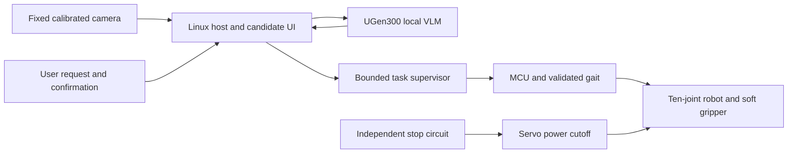

# TailMate Fetch

A proposed local AI companion for retrieving dropped essentials, built around an existing tail-shaped robot.

**ASUS UGen AI League 2026 proposal**  
Theme: Everyday AI  
Battlefield: Lightning, ASUS UGen300  
Proposed format: Global Online Track  
Team: Beavers Hive (ビーバーズ・ハイブ)

## Current status

The supplied mechanical prototype footage shows waist mounting and floor locomotion. The original entry sheet reports a roughly 1 m, 1–1.5 kg body with ten FEETECH STS3215 servos. Those specifications have not been independently measured here.

This repository adds a **software-only dry-run reference supervisor**, synthetic replay inputs, tests, an integration design, and a planned evaluation protocol. It does not contain the original robot firmware, a trained perception model, or an integrated retrieval system. It does not connect to a camera, UGen300, serial port, servo, or network service.

**UGen300 inference, calibrated approach, soft grasping and return to a tray are Stage II development goals.** No retrieval success rate, hardware stop response or AI latency result is available yet.

## User task

A user identifies a dropped item and confirms a candidate image. A local vision model helps check object identity. A deterministic supervisor then coordinates a bounded approach, grasp, and return to a floor-level tray. The first integration uses an empty eyeglass case on a supervised mat. Key pouches and cloth follow. Bare glasses require additional damage and contact-force tests.

The hackathon MVP operates off the body on a short, calibrated route. The wearable companion experience remains a longer-term design direction.

## Run the reference software

Python 3.10 or later, standard library only:

```bash
python3 replay.py
python3 replay.py examples/blocked.json
python3 -m unittest discover -s tests -v
```

Every output says `DRY_RUN`. `SIMULATED_*` events describe intended task-level actions and never command hardware. Inputs in `examples/` are synthetic fixtures, not model predictions or experimental results. This supervisor is a contract example and is not a certified safety controller.

## Architecture



The diagram describes a proposed integrated system. Only the dry-run supervisor exists in this package. See [architecture](docs/architecture.md), [model plan](docs/model_plan.md), and [evaluation protocol](docs/evaluation_protocol.md).

## Repository map

- `replay.py`: deterministic task replay with no device or network access.
- `examples/`: successful-path and blocked-path synthetic inputs.
- `tests/`: contract checks for authorization, input freshness and rejection conditions.
- `docs/`: implementation plan, model notes and an evidence ledger.
- `results/trials_template.csv`: empty template for future measured trials.
- `evidence/`: images and silent video from the team-supplied prototype materials.

## Planned development

1. Nov 6–12: confirm UGen300 host/runtime compatibility, camera calibration and offline model output.
2. Nov 13–19: validate approach, physical stop, watchdog and tracking loss behavior.
3. Nov 20–26: integrate a soft gripper and repeat eyeglass-case retrieval.
4. Nov 27–Dec 4: run the declared evaluation, record failures, and publish reproducible logs and an uncut integrated demo.

These dates follow the competition's published Stage II period. Actual progress depends on hardware availability and mechanical test results.

## Evidence and attribution

The team supplied a Japanese entry sheet and a 25.833-second video. The video establishes mechanical motion, not AI operation. The concept image depicts an intended experience and is not a prototype photograph. See [evidence ledger](docs/evidence_ledger.md) for provenance and limitations.

The team stated on October 17, 2026 that the work had not been submitted, publicly released or exhibited. Any subsequent publication should be checked against the competition's originality rule and the submission workflow. Publishing a judge-accessible repository is itself required for the application.

## References

- [Competition rules and schedule](https://contest.bhuntr.com/en/39jg9vimiynrhlksze/home/)
- [ASUS UGen300 product information](https://www.asus.com/uk/motherboards-components/ai-accelerator/ugen/ugen300-usb-8g/)
- [Hailo official applications](https://github.com/hailo-ai/hailo-apps)
- [Hailo candidate VLM guide](https://github.com/hailo-ai/hailo-apps/blob/main/.hailo/instructions/gen-ai-development.md)

References checked October 17, 2026. Pin the actual runtime, model and code versions when hardware validation begins. Model weights and vendor code are not bundled here. No third-party model license or publication license for the team's work is granted by this package.
